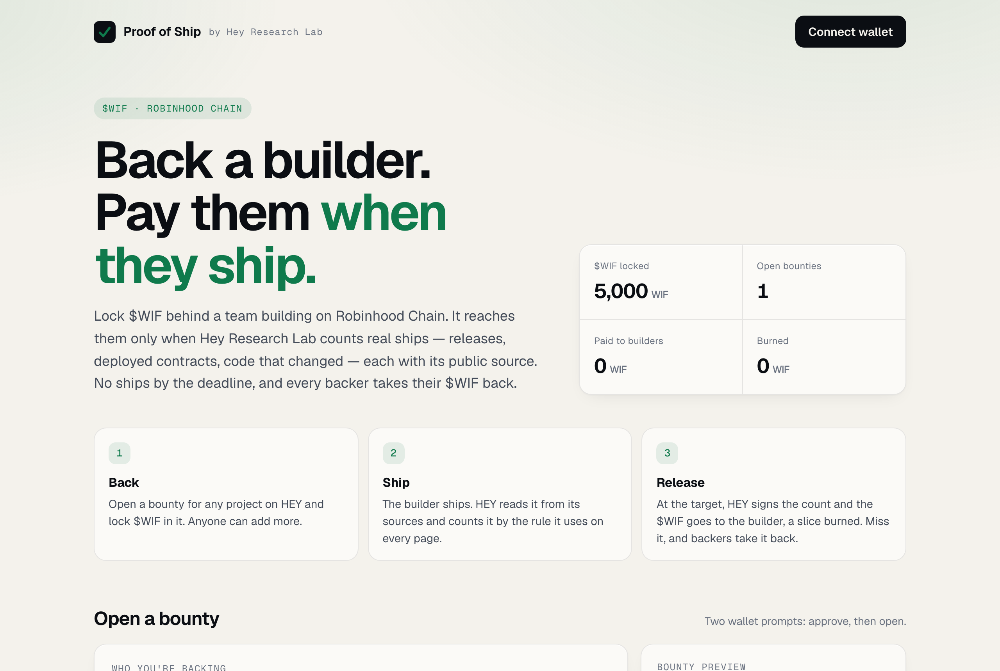
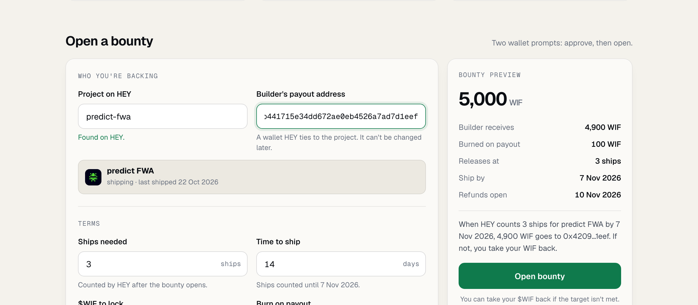
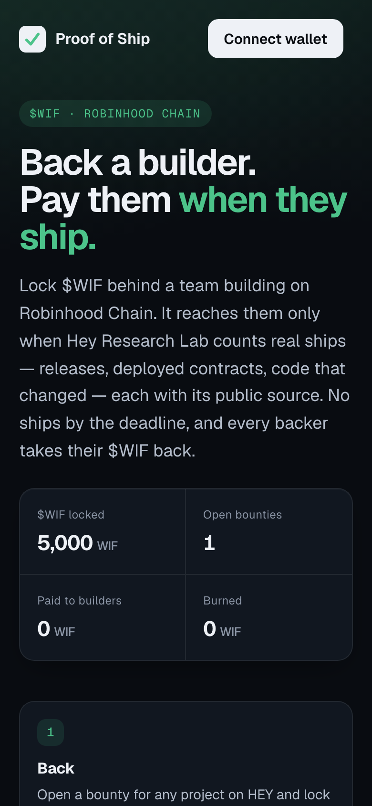

<a href="https://hey-research-lab.github.io/proof-of-ship/">
  <picture>
    <source media="(prefers-color-scheme: dark)" srcset="docs/hero-dark.svg">
    
  </picture>
</a>

<p align="center">
  <a href="https://github.com/hey-research-lab/proof-of-ship/actions/workflows/ci.yml"></a>
  <a href="https://repo.sourcify.dev/4663/0x3Da17a89F1d29aB96419269514C798a8dd6125f2"></a>
  <a href="LICENSE"></a>
</p>

<p align="center">
  <a href="https://hey-research-lab.github.io/proof-of-ship/"><b>Open the app</b></a> ·
  <a href="https://hey-research-lab.github.io/proof-of-ship/?chain=near"><b>Open it on NEAR</b></a> ·
  <a href="https://hey-research-lab.github.io/proof-of-ship/demo.html"><b>Watch the demo</b></a> ·
  <a href="https://worldisflat.fun/build/projects/proof-of-ship"><b>Follow on World is Flat</b></a> ·
  <a href="https://heyresearch.xyz"><b>Hey Research Lab</b></a>
</p>

**Proof of Ship** is an escrow on Robinhood Chain that pays builders in $WIF for shipping, not for promising. Anyone
locks $WIF behind a team, and it is released only when [Hey Research Lab](https://heyresearch.xyz) counts real ships
for that team, each with its public source; if the target is not met by the deadline, every backer takes their $WIF back.

The same page also runs **Proof of Ship on NEAR**: USDC bounties in the escrow
[`escrow.heyresearch.near`](https://nearblocks.io/address/escrow.heyresearch.near)
([source](https://github.com/hey-research-lab/proof-of-ship-near)), released on the same signed count. See
[On NEAR](#on-near-usdc).

**One page, both chains.** HEY signs one count per claim; each escrow checks it under its own EIP-712 domain
(Robinhood Chain: chain id 4663 with ShipEscrow as `verifyingContract`; NEAR: chain id 397 with
`salt = keccak256("escrow.heyresearch.near")`), so one attestation is paid by one escrow only. The page shows:

| Part | What it reads |
| :-- | :-- |
| The diagram | the attester each escrow names (`attester()`, `get_config`) and the domain separator each one computes, beside the one the page computes from the domain |
| The figures | bounties, open now, locked now, paid to builders, builders paid and burned, per chain and for both, from the two contracts. WIF and USDC stay in their own units, side by side, never added up |
| Bounties | one list of both chains' funded bounties, a chain badge, a countdown and the counted ships with their sources on every card; filter All, Robinhood Chain or NEAR; ordered by date only (newest, or ending soonest), never by amount |
| Activity | opened, funded, released and refunded on both chains, newest first, each linked to its transaction: ShipEscrow's events over public RPC (`eth_getLogs` from its deploy block), the NEAR escrow's NEP-297 events from FastNear's public transactions API (`tx.main.fastnear.com`). When that API cannot be read, NEAR bounties show when they opened, from the escrow's own state, linked to the escrow on nearblocks: no hash is made up |
| `?project=<slug>` | every bounty for one project on both chains, HEY's counted ships for it over the last 30 days, **Back this builder** (the chosen chain's form, prefilled), a link to copy and a badge snippet (`<a>` and an image, no frame, no script) |
| Verify a receipt | paste HEY's attestation JSON: the page rebuilds the EIP-712 digest and recovers the signer with viem in your browser, says whether it is HEY's attester (`0x2b30…5760`) and which escrow and chain the domain binds to, and asks the escrow itself (ShipEscrow's `digest()`, the NEAR escrow's `recover_signer`). **Try an example** fetches a live attestation, no wallet needed |

Light and dark follow the system, or the reader's choice from the header (remembered in this browser).

<picture>
  <source media="(prefers-color-scheme: dark)" srcset="docs/stats-dark.svg">
  
</picture>

## Bounties

<!-- bounties:start -->
2 bounties on chain, newest first. Read from the escrow's events every day; each bounty number opens its card in the app.

| Bounty | Project | Amount | Target | Deadline | Status | Opened |
| :-- | :-- | --: | :-- | :-- | :-- | :-- |
| [#1](https://hey-research-lab.github.io/proof-of-ship/#bounty-1) | [fly-ai](https://heyresearch.xyz/project/fly-ai) | 5,000 WIF | 3 ships | 10 Nov 2026, 19:38 UTC | **Open** | [`0x9fa0…8c6d`](https://robinhoodchain.blockscout.com/tx/0x9fa062076690c34b94c11bae8c7c57cb73cd89e1677937029913d7175e9d8c6d) |
| [#0](https://hey-research-lab.github.io/proof-of-ship/#bounty-0) | [predict-fwa](https://heyresearch.xyz/project/predict-fwa) | 5,000 WIF | 3 ships | 6 Nov 2026, 18:25 UTC | **Paid** at 3 ships: 4,900 WIF to the builder, 100 burned · [`0xd196…ab57`](https://robinhoodchain.blockscout.com/tx/0xd19654c02474c71beb664e8b35aefc0e57eefaa8330707037245b3e95285ab57) | [`0x3e48…5603`](https://robinhoodchain.blockscout.com/tx/0x3e48e2d8ff9cb942bb580a8434f2ab4c4bc89e48e103f4c9dbb49e8ff6535603) |
<!-- bounties:end -->

## Try it

| | |
| :-- | :-- |
| **The app** | [hey-research-lab.github.io/proof-of-ship](https://hey-research-lab.github.io/proof-of-ship/): open a bounty, add $WIF to one, release it or take a refund. Bounties and stats are read straight from the chain, so looking needs no wallet. |
| **The demo** | [a short video of the whole flow](https://hey-research-lab.github.io/proof-of-ship/demo.html), from opening a bounty to the release. |
| **Follow the build** | [Proof of Ship on World is Flat](https://worldisflat.fun/build/projects/proof-of-ship): every update, and a vote when voting opens. Built for the [World is Flat hackathon](https://worldisflat.fun/build). |

<p align="center">
  <picture>
    <source media="(prefers-color-scheme: dark)" srcset="docs/app-dark.png">
    
  </picture>
</p>

## On NEAR (USDC)

Built for the NEAR HACKATHON. Press **NEAR** at the top of the page, or open
[hey-research-lab.github.io/proof-of-ship/?chain=near](https://hey-research-lab.github.io/proof-of-ship/?chain=near).
Robinhood Chain stays the default and works exactly as before.

| Do | See |
| :-- | :-- |
| Open the page with `?chain=near` | The NEAR view: USDC in the escrow, open bounties, paid to builders and bounties on NEAR, read live from `escrow.heyresearch.near` over public NEAR RPC (`get_config`, `bounty_count`, `get_bounties`, `ft_balance_of`). No wallet needed. |
| Type `predict` in **Project on HEY** and pick predict FWA | The payout address fills in from HEY's tie route, with the NEAR account it pays: the address in lower case, `0x420944b441715e34dd672ae0eb4526a7ad7d1eef`. The page then asks HEY's attestation route for a signature with `escrow=near:escrow.heyresearch.near` and checks it recovers HEY's attester under the NEAR domain (chain 397, `salt = keccak256("escrow.heyresearch.near")`). |
| Look under **Ships needed** once a project is picked | HEY's own count of the last 14 days by the payout rule, from `/api/v1/proof-of-ship/ships`: "By HEY's count, predict FWA shipped N times in the last 14 days (about M a week). A target of T in D days looks likely / tight / unlikely." Likely when the target is at most 3/4 of the last 14 days' pace over D days, tight up to 5/4, unlikely above (or when HEY counted none). A project HEY can't measure says so with HEY's reason, never 0. |
| The same, while HEY is not signing for NEAR yet | A banner and the payout hint say so plainly, and **Open bounty** sends nothing: no USDC is locked behind a payout HEY cannot sign. |
| Switch **Payout** to NEAR Intents | The preview says the USDC goes into NEAR Intents (`intents.near`) for the same `0x…` account. |
| **Connect NEAR wallet** (Meteor first, or MyNearWallet), then **Open bounty** | First a summary to confirm, built from the exact deadline that will be sent: "You're locking X USDC for P. P must ship N times by <weekday, date, HH:MM> UTC" with the same time in your own zone, the claim window and the refund date, and the deadline in unix seconds as the wallet shows it. If the days field changed after the summary was shown, nothing is sent. **Confirm and open bounty**, then prompt 1: `create(builder, slug, min_ships, deadline, payout)` on the escrow with 0.01 NEAR for storage (the unused part comes back). The preview then shows **Fund #N with … USDC**. |
| Press **Fund #N with … USDC** | Prompt 2: `ft_transfer_call` on USDC to the escrow with `msg` `{"action":"fund","id":N}` and 1 yoctoNEAR. The bounty card shows the USDC locked. Anyone can add more with **Add USDC**. |
| On a bounty whose target is met, press **Release to builder** | "HEY counts N ships" with each ship's evidence link, after the escrow's own `recover_signer` view answered `is_attester: true` for HEY's signature. **Submit the claim** sends `claim(id, attestation, signature)` with 0.00125 NEAR (the builder's USDC storage, returned if not needed) and 150 TGas. Anyone can submit it: the recipient is fixed by the signature. |
| After the deadline plus 3 days, unclaimed, with the wallet you funded from | **Take back** with exactly what you locked: `refund(id)`. |
| `curl -s https://free.rpc.fastnear.com -H 'content-type: application/json' -d '{"jsonrpc":"2.0","id":1,"method":"query","params":{"request_type":"call_function","finality":"final","account_id":"escrow.heyresearch.near","method_name":"get_config","args_base64":"e30="}}'` | The escrow's fixed config as bytes of JSON: attester `0x2b30…5760`, USDC, chain id 397, guardian `heyresearch.near`, intents `intents.near`. |
| Look at any NEAR bounty | Time left to ship (then to claim), updated each minute; Ship by, Claim until (deadline plus 3 days) and Refunds from; the ships HEY has counted so far in the bounty's window, each linked to its evidence; **Post on X** with a ready post under 280 characters, and **Copy link**. |
| `cd test/page && npm ci && npx playwright-core install chromium && node run.mjs` | 225 checks pass against mocked chains, a mocked HEY, a mocked FastNear and test wallets, with every other host refused: the Robinhood Chain flow up to its first wallet prompt; the whole NEAR flow (not signing, then the target hint, the confirmation and the exact deadline it sends, open, fund, claim and refund, the countdown, the timeline and the X post); the figures of both chains, the one list with its filter and date order, the diagram, the activity feed (a retry, and its fallback), the project view, verify-a-receipt (HEY's signature, a wrong signer, a signature moved to the other domain, a NEAR one cross-checked with `recover_signer`), the theme toggle, 4.5:1 text contrast in both themes and the HEY mark; plus screenshots at 1280 and 400 px, light and dark, in `test/page/shots/`. |

**Where the money goes.** HEY's signature names the builder by an EVM address. The builder is paid at the NEAR
eth-implicit account of that address, `0x` and its 40 hex characters in lower case, which the same Ethereum wallet
controls; the escrow registers it with USDC if needed, so it does not have to exist first. With the NEAR Intents
payout, the USDC sits in `intents.near` under that same `0x…` account, for the builder to withdraw cross-chain.

| | NEAR mainnet |
| :-- | :-- |
| **Escrow** | [`escrow.heyresearch.near`](https://nearblocks.io/address/escrow.heyresearch.near) · [source](https://github.com/hey-research-lab/proof-of-ship-near). It still holds one full-access key until the operator deletes it; the page reads the account's keys live and says how many |
| **Token** | USDC on NEAR, [`17208628f84f5d6ad33f0da3bbbeb27ffcb398eac501a31bd6ad2011e36133a1`](https://nearblocks.io/address/17208628f84f5d6ad33f0da3bbbeb27ffcb398eac501a31bd6ad2011e36133a1) (6 decimals) |
| **Attester** (Hey Research Lab) | `0x2b309b352Ff49d04912Ca34984B27a5481325760`, the same key as on Robinhood Chain, under a NEAR-only domain |
| **Guardian** (can only retire) | [`heyresearch.near`](https://nearblocks.io/address/heyresearch.near) |
| **HEY routes** | [`/api/v1/proof-of-ship/tie?slug=`](https://heyresearch.xyz/api/v1/proof-of-ship/tie?slug=predict-fwa) and `/api/v1/proof-of-ship/attestation?slug=&builder=&since=&until=&escrow=near:escrow.heyresearch.near` |

No burn on NEAR: a USDC bounty pays the builder in full. The testnet escrow trusts a public test key, so HEY never
signs for it and the page does not show it. The NEAR wallet code (NEAR Wallet Selector 10.1.4 with Meteor and
MyNearWallet) is bundled into `app/vendor/near.js` from a pinned lockfile and loads only when a reader connects.

## Why you can trust it

| | |
| :-- | :-- |
| **No owner and no admin key** | No one can upgrade the contract or send its $WIF anywhere else. It leaves the escrow only as a release to the payout wallet the bounty named, minus its burn share, or as each backer's own refund. |
| **A guardian that can only stop** | A separate cold key can retire the escrow if HEY's signing key were ever lost. Claims stop and every backer can refund at once. It cannot send a single token anywhere else. |
| **HEY signs a count, not a verdict** | The signature says how many ships HEY counted for the project in the bounty's window. It does not say the project is good, safe or worth funding. |
| **One ship of each kind a day** | For a bounty, HEY counts at most one release, one contract deployment or upgrade, one code week and one other entry per day, and only ships it first recorded inside the window. |
| **Paid only to a wallet HEY ties to the project** | Either the deployer of the project's token, once HEY reads that token as the project's own, or a wallet that signed the project's claim on HEY for that token. HEY never signs for any other address. |
| **Source verified** | [Sourcify exact match](https://repo.sourcify.dev/4663/0x3Da17a89F1d29aB96419269514C798a8dd6125f2): the code in `src/` is the code that holds the $WIF. 38 contract tests, with fuzz tests at 2,000 runs, including the whole flow against the real $WIF on a fork (run when `FORK_RPC` is set). |

## For builders

There is nothing to apply for. Keep shipping on Robinhood Chain; when someone backs you, HEY counts what you ship
the same way it does on every project page.

Check whether HEY can pay you, before anyone opens a bounty:

```
GET https://heyresearch.xyz/api/v1/proof-of-ship/tie?slug=<your-slug>
```

It answers `payable` and the addresses HEY ties to your project (`token_deployer` or `wallet_claim`). If it ties none,
claim your page on [heyresearch.xyz](https://heyresearch.xyz) with a wallet signature for your token, or pay out to the
wallet that deployed your token. In the app, connect your payout wallet and a banner shows what is waiting for you:
the amount, HEY's signed count against the target, and the deadline.

## How it works

<picture>
  <source media="(prefers-color-scheme: dark)" srcset="docs/flow-dark.svg">
  
</picture>

| Step | What happens |
| :-- | :-- |
| **1. Back** | Anyone opens a bounty for a project with a page on HEY (`heyresearch.xyz/project/<slug>`): the builder's payout wallet, how many ships, a deadline, a burn share of 0 to 10%, and the $WIF to lock. Anyone can add more. |
| **2. Ship** | The builder ships. HEY counts by the rule it uses on every page: corroborated building evidence. A repository's releases of one day count once, a deploy script's contracts count once, and docs-only weeks, dependency bumps, CI-only commits and automation never count. A code week counts only once it has ended inside the window. |
| **3. HEY counts** | At the target, anyone asks HEY for a signed count. HEY signs it as EIP-712 typed data for that payout wallet and that window, with the hash of the exact ship ids it rests on. |
| **4. Release, or refund** | Anyone submits the count; the escrow pays the builder and burns the share the backer chose. Target not met by the deadline, plus a 3-day grace for ships made before it? Every backer takes back exactly what they put in. |

<details>
<summary><b>Contracts and addresses</b></summary>

| | Robinhood Chain (4663) |
| :-- | :-- |
| **ShipEscrow** | [`0x3Da17a89F1d29aB96419269514C798a8dd6125f2`](https://robinhoodchain.blockscout.com/address/0x3da17a89f1d29ab96419269514c798a8dd6125f2) · source on [Sourcify](https://repo.sourcify.dev/4663/0x3Da17a89F1d29aB96419269514C798a8dd6125f2) (exact match) |
| **Attester** (Hey Research Lab) | [`0x2b309b352Ff49d04912Ca34984B27a5481325760`](https://robinhoodchain.blockscout.com/address/0x2b309b352ff49d04912ca34984b27a5481325760) |
| **Guardian** (can only retire) | [`0x2f7D93Eed05439bFf41e602f37A8792Af731b736`](https://robinhoodchain.blockscout.com/address/0x2f7d93eed05439bff41e602f37a8792af731b736) |
| **$WIF** | [`0x5173b8eA6923c2d40267890D45C46a3480954773`](https://robinhoodchain.blockscout.com/token/0x5173b8ea6923c2d40267890d45c46a3480954773) |
| **Deployed** | [`0xef19…d071`](https://robinhoodchain.blockscout.com/tx/0xef19bc5c4a756a66365f797a27c4223ab65c69c2d55ccb675d4dd1acd22ed071), block 96,136,035 |
| **Burn address** | `0x000000000000000000000000000000000000dEaD`, at release only. A refunded bounty burns nothing. |

`src/ShipEscrow.sol` is one contract:

| Function | Who | What |
| :-- | :-- | :-- |
| `create(token, builder, slug, minShips, deadline, burnBps, amount)` | anyone | opens a bounty; `project = keccak256(slug)`, `start = now` |
| `fund(id, amount)` | anyone | adds to an open bounty (credits what actually arrived) |
| `claim(id, ships, signature)` | anyone | pays the bounty's builder when HEY's signature says `ships >= minShips` |
| `refund(id)` | each backer | returns their own contribution after `deadline + 3 days`, if unclaimed |
| `retire()` | guardian | stops claims for good and opens refunds at once |

</details>

<details>
<summary><b>The EIP-712 type HEY signs</b></summary>

Domain `"HEY Proof of Ship"`, version `1`, chain 4663, this contract as `verifyingContract`:

```solidity
Ships(bytes32 project, address builder, uint64 since, uint64 until, uint32 ships, bytes32 evidence, uint64 issuedAt)
```

`project` is `keccak256` of the project's HEY slug. `builder` must equal the bounty's payout wallet, `since` its start,
`until` cannot pass its deadline, `issuedAt` is within the last day, and `evidence` hashes the exact sorted ship ids
(`ship:<uuid>`) the count rests on; each opens on HEY with its source.

It means HEY counted this many ships for this project in this window, by the same rule as activity status on
heyresearch.xyz. It changes nothing on HEY: no status, score or order reads a bounty. HEY holds, moves and earns
nothing in an escrow.

</details>

<details>
<summary><b>The HEY endpoints the app uses</b></summary>

All public, no key. The page reads them from your browser; it loads no third-party script (viem, WalletConnect and the
NEAR Wallet Selector are bundled into `app/vendor/` and the page sets `script-src 'self'`). Besides HEY it reads
Robinhood Chain's and NEAR's public RPC, and FastNear's public transactions API for the NEAR activity feed.

| Endpoint | For |
| :-- | :-- |
| `GET /api/v1/proof-of-ship/attestation?slug=&builder=&since=&until=&escrow=` | the signed count a release submits; also how the page checks a payout wallet as you type. `escrow=0x3Da1…25f2` on Robinhood Chain, `escrow=near:escrow.heyresearch.near` on NEAR |
| `GET /api/v1/proof-of-ship/ships?slug=&since=&until=` | HEY's unsigned count for a closed window, by the payout rule: the NEAR form's target hint over the last 14 days |
| `GET /api/v1/proof-of-ship/tie?slug=` | the addresses HEY ties to a project, to fill in or offer the payout wallet |
| `GET /api/projects/<slug>` | the project card on a bounty, and its official X for a post that tells the builder |
| `GET /api/projects/<slug>/timeline` | the ships HEY counted, up to five on each card, with the day HEY first recorded each |
| `GET /api/search/suggest?q=` | the project field, which writes the project's exact slug when you pick one |
| `GET /api/v1/proof-of-ship/ships?slug=&since=&until=` (30 days) | the project view's counted ships |

</details>

<details>
<summary><b>What is in the app</b></summary>

<table>
  <tr>
    <td width="68%">
      <picture>
        <source media="(prefers-color-scheme: dark)" srcset="docs/compose-dark.png">
        
      </picture>
    </td>
    <td width="32%"></td>
  </tr>
  <tr>
    <td><sub>Open a bounty: HEY's card for the project, a payout wallet checked against HEY's tie rule as you type, and a live preview of what it pays, burns and when refunds open.</sub></td>
    <td><sub>Works at 375 px, light and dark. On a phone with no wallet it opens the page in MetaMask, Coinbase, Trust or OKX, or connects through WalletConnect.</sub></td>
  </tr>
</table>

- **Wallets:** browser wallets (EIP-6963, each extension listed) and WalletConnect, a *Switch to Robinhood Chain* prompt
  on the wrong network, an account menu with copy, explorer and disconnect. The last wallet comes back on reload
  without a prompt.
- **Opening a bounty:** the project field searches HEY as you type and writes the project's exact slug when you pick
  one; a slug typed by hand is used exactly as typed. The payout wallet is filled in when HEY ties one address to the
  project, offered as a choice when it ties two, and the page says plainly when it ties none (such a bounty can only be
  refunded after its deadline). Time to ship is 7, 14 or 30 days, or any 1 to 365.
- **Each bounty card** has its own address (`#bounty-<id>`), a *Share on X* link with a factual post and a *Copy link*
  button. An open bounty's *Tell the builder* link drafts a post that tags the project's official X only when HEY reads
  the account as active and holds no hold on it.

</details>

<details>
<summary><b>Build and verify</b></summary>

```bash
forge install
forge test                                                              # 37 tests; the fork test skips without FORK_RPC
FORK_RPC=https://rpc.mainnet.chain.robinhood.com forge test --mc Fork   # the full flow with the real $WIF
python3 -m http.server -d app                                           # the app: static, no build step
(cd test/page && npm ci && npx playwright-core install chromium && node run.mjs)  # page checks, both chains, mocked
sh vendor-build/build.sh                                                # rebuild app/vendor and check SHA256SUMS
(cd test/page && node og.mjs)                                           # redraw app/og.png, the social image
node --no-warnings scripts/stats.mjs                                    # redraw this README's pictures and table
```

Deployed by a person from their own wallet, never from CI:
`ATTESTER=0x… GUARDIAN=0x… forge script script/Deploy.s.sol --rpc-url robinhood --broadcast`.

The stats card and the bounties table are redrawn once a day by [`.github/workflows/stats.yml`](.github/workflows/stats.yml)
from the escrow's own events on Robinhood Chain. A read that fails, or that disagrees with the contract's own
`bountyCount()` and balance, writes nothing, so the last good figures stay.

</details>

<details>
<summary><b>Security</b></summary>

Before mainnet, an independent adversarial review found that the payout wallet was not signed, so an impostor bounty
could have been paid by a real project's ships. Now HEY signs it and the escrow checks it. After launch, HEY's full
audit found two ways to game the count: work pushed after the deadline and dated back, and many small entries in one
day. Both are closed: only ships first recorded inside the window count, and at most one of each kind a day.

The tests cover impostor payees, replays across bounties, escrows and chains, malleable signatures and reentrant tokens
([`test/ShipEscrow.replay.t.sol`](test/ShipEscrow.replay.t.sol) holds the last three: a chain-id change, a high-s signature and
a token hook re-entering `claim`, `refund` and `fund`).
What the escrow trusts, and how to report a vulnerability privately: [SECURITY.md](SECURITY.md).

</details>

<details>
<summary><b>Questions</b></summary>

**Can I open a bounty for any project?** Any project with a page on HEY. The payout wallet must be one HEY ties to that
project. If it is not, HEY never signs, and backers refund after the deadline. The app checks the wallet as you type.

**What if HEY disappears?** Every bounty refunds after its deadline plus 3 days, without HEY. If HEY's key were ever
compromised, the guardian retires the escrow and refunds open at once.

**A project was renamed on HEY.** Its old slug keeps working: HEY signs for the slug the bounty was opened with.

</details>

<p align="center">
  <sub>By <a href="https://heyresearch.xyz">Hey Research Lab</a> · <a href="SECURITY.md">Security</a> · <a href="LICENSE">MIT</a> · Not affiliated with or endorsed by Robinhood · Not financial advice</sub>
</p>
