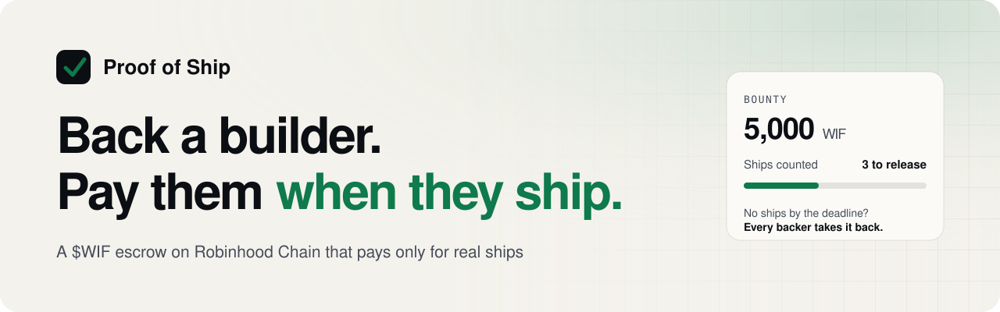
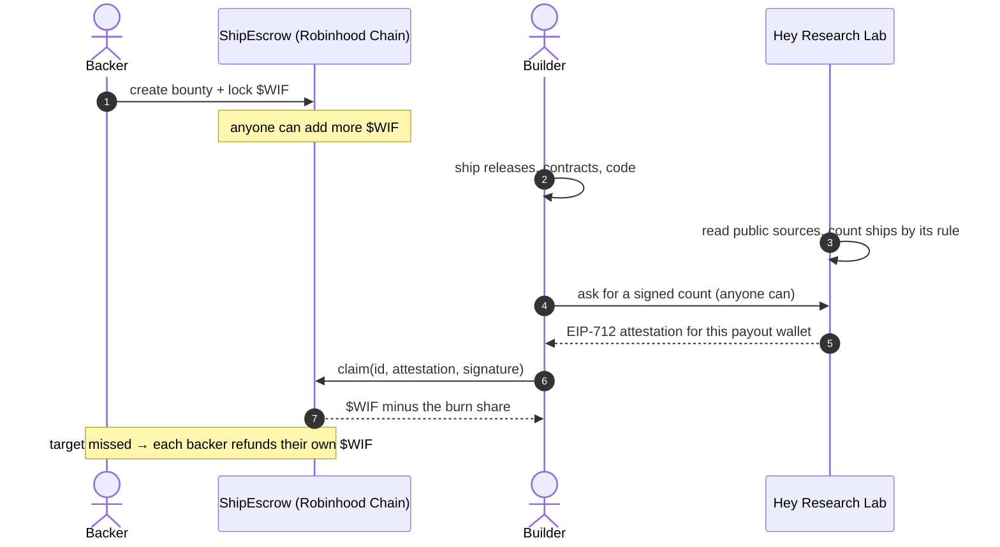
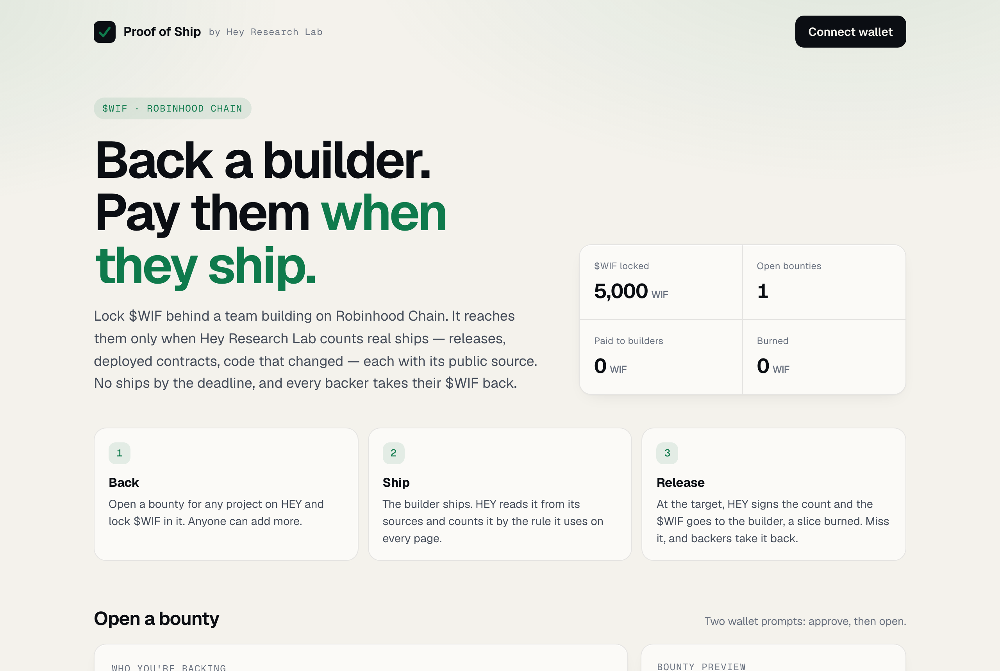
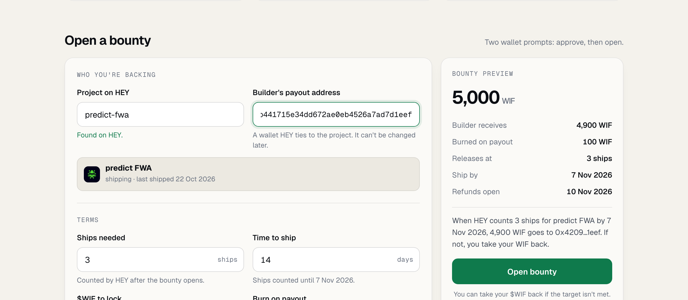
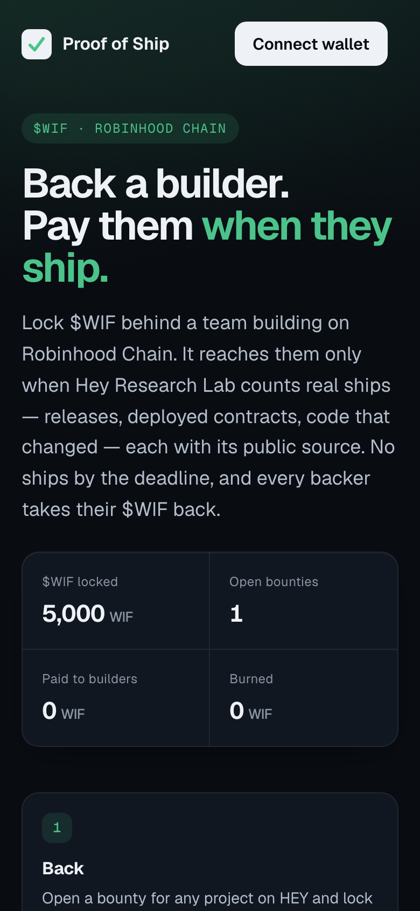

<p align="center">
  <picture>
    <source media="(prefers-color-scheme: dark)" srcset="docs/banner-dark.svg">
    
  </picture>
</p>

<p align="center">
  <a href="https://hey-research-lab.github.io/proof-of-ship/"><b>Open the app</b></a> ·
  <a href="https://hey-research-lab.github.io/proof-of-ship/demo.html"><b>Watch the demo</b></a> ·
  <a href="https://robinhoodchain.blockscout.com/address/0x3da17a89f1d29ab96419269514c798a8dd6125f2"><b>Escrow on chain</b></a> ·
  <a href="https://heyresearch.xyz"><b>Hey Research Lab</b></a>
</p>

<p align="center">
  <a href="https://github.com/hey-research-lab/proof-of-ship/actions/workflows/ci.yml"></a>
  <a href="https://repo.sourcify.dev/4663/0x3Da17a89F1d29aB96419269514C798a8dd6125f2"></a>
  
  
  <a href="#live-on-robinhood-chain"></a>
  <a href="LICENSE"></a>
</p>

<p align="center"><i>Built for the <a href="https://worldisflat.fun/build">World is Flat hackathon</a>.</i></p>

---

**Proof of Ship** is an escrow that pays builders in **$WIF** for shipping, not for promising. Anyone locks $WIF behind
a team building on Robinhood Chain. It is released only when [Hey Research Lab](https://heyresearch.xyz) counts real
ships for that team — releases, deployed contracts, code that changed — each with its public source. No ships by the
deadline, and every backer takes their $WIF back.

## Why

Holders want the token they hold to be **used**. Builders need **runway** to build things that use it. The usual
answers are a grant someone decides on, or a promise nobody checks. Proof of Ship replaces both with **evidence**:
backers fund a bounty, the builder ships, and the money moves only when an independent reader of public sources says
the shipping happened.

## How it works



| Step | What happens |
| :-- | :-- |
| **1 · Back** | Anyone opens a bounty for a project with a page on HEY (`heyresearch.xyz/project/<slug>`): the builder's payout wallet, how many ships, a deadline, a burn share of 0–10%, and the $WIF to lock. Anyone can add more. |
| **2 · Ship** | The builder ships. HEY counts by the rule it uses on every page: corroborated building evidence; a repository's releases of one day count once; a deploy script's contracts count once; docs-only weeks, dependency bumps, CI-only commits and automation never count. For a bounty it also counts only ships it first recorded inside the bounty window, and at most one ship of each kind per day. |
| **3 · Release** | At the target, anyone asks HEY for a signed count and submits it. The escrow pays the builder and burns the share the backer chose. |
| **4 · Or refund** | Missed the deadline (plus a 3-day grace for ships made before it)? Every backer takes back exactly what they put in. |

### The flywheel

> Backers put idle $WIF to work → builders ship things on Robinhood Chain, many of them for $WIF itself → every
> payout puts $WIF in a builder's hands and burns a slice → more working utility gives more holders a reason to back
> the next builder.

## See it

<p align="center">
  <picture>
    <source media="(prefers-color-scheme: dark)" srcset="docs/app-dark.png">
    
  </picture>
</p>

<table>
  <tr>
    <td width="68%">
      <picture>
        <source media="(prefers-color-scheme: dark)" srcset="docs/compose-dark.png">
        
      </picture>
    </td>
    <td width="32%"></td>
  </tr>
  <tr>
    <td><sub>Open a bounty: HEY's card for the project, a payout wallet checked against HEY's tie rule as you type, and a live preview of what it pays, burns and when refunds open.</sub></td>
    <td><sub>Works at 375 px, light and dark. On a phone with no wallet it opens the page in MetaMask, Coinbase, Trust or OKX — or WalletConnect.</sub></td>
  </tr>
</table>

**In the app:** browser wallets (EIP-6963, each extension listed) and **WalletConnect** · a *Switch to Robinhood Chain*
prompt on the wrong network · an account menu with copy, explorer and disconnect · the last wallet comes back on reload
without a prompt · bounties and stats read straight from the chain, no wallet needed to look.

## Live on Robinhood Chain

| | Robinhood Chain (4663) |
| :-- | :-- |
| **ShipEscrow** | [`0x3Da17a89F1d29aB96419269514C798a8dd6125f2`](https://robinhoodchain.blockscout.com/address/0x3da17a89f1d29ab96419269514c798a8dd6125f2) · source on [Sourcify](https://repo.sourcify.dev/4663/0x3Da17a89F1d29aB96419269514C798a8dd6125f2) (exact match) |
| **Attester** (Hey Research Lab) | [`0x2b309b352Ff49d04912Ca34984B27a5481325760`](https://robinhoodchain.blockscout.com/address/0x2b309b352ff49d04912ca34984b27a5481325760) |
| **Guardian** (can only retire) | [`0x2f7D93Eed05439bFf41e602f37A8792Af731b736`](https://robinhoodchain.blockscout.com/address/0x2f7d93eed05439bff41e602f37a8792af731b736) |
| **$WIF** | [`0x5173b8eA6923c2d40267890D45C46a3480954773`](https://robinhoodchain.blockscout.com/token/0x5173b8ea6923c2d40267890d45c46a3480954773) |
| **Deployed** | [`0xef19…d071`](https://robinhoodchain.blockscout.com/tx/0xef19bc5c4a756a66365f797a27c4223ab65c69c2d55ccb675d4dd1acd22ed071), block 96,136,035 |
| **First bounty** | #0 · 5,000 $WIF for [predict FWA](https://heyresearch.xyz/project/predict-fwa), released at 3 ships · [`0x3e48…5603`](https://robinhoodchain.blockscout.com/tx/0x3e48e2d8ff9cb942bb580a8434f2ab4c4bc89e48e103f4c9dbb49e8ff6535603) |

## Built to be trusted

| | |
| :-- | :-- |
| 🔒 **No owner, no admin key, no upgrade** | $WIF leaves the escrow only as a release to the builder the bounty named (minus its burn), or as each backer's own refund. |
| ✅ **Source verified** | [Sourcify exact match](https://repo.sourcify.dev/4663/0x3Da17a89F1d29aB96419269514C798a8dd6125f2): the code you read is the code that holds the $WIF. |
| 🧪 **33 contract tests + a fork test** | Unit, fuzz (2,000 runs) and attacks — impostor payees, replays across bounties, escrows and chains, malleable signatures, reentrant tokens — plus the whole flow against the real $WIF on a fork. |
| 🔍 **Reviewed adversarially, twice** | Before mainnet an independent review found the payout wallet wasn't signed (an impostor bounty could have been paid by a real project's ships): now it is, and the escrow checks it. After launch HEY's full audit found two ways to game the count; both are closed (below). |
| 🛑 **A guardian that can only stop** | If HEY's signing key were ever lost, a separate cold key can retire the escrow: claims stop, every backer refunds at once. It can't move a single token anywhere else. |
| 🧱 **No third-party script at runtime** | viem and WalletConnect are bundled into `app/vendor/`; the page sets `script-src 'self'`. |

**Who HEY signs for.** Only a payout wallet its evidence ties to the project: the signer of a verified wallet-signature
claim made for the project's **current** token, or that token's recorded deployer — never a disowned, contested or
issuer token, never a deployer whose launch history HEY hasn't read. A renamed project's old slug keeps working.

**What it counts.** Ships first recorded inside the bounty window (work pushed after the deadline and dated back never
counts), and at most one ship of each kind — a release, a contract deployment or upgrade, a code week, any other entry —
per day.

## The contract

`src/ShipEscrow.sol` — one contract.

| Function | Who | What |
| :-- | :-- | :-- |
| `create(token, builder, slug, minShips, deadline, burnBps, amount)` | anyone | opens a bounty; `project = keccak256(slug)`, `start = now` |
| `fund(id, amount)` | anyone | adds to an open bounty (credits what actually arrived) |
| `claim(id, ships, signature)` | anyone | pays the bounty's builder when HEY's signature says `ships ≥ minShips` |
| `refund(id)` | each backer | returns their own contribution after `deadline + 3 days`, if unclaimed |
| `retire()` | guardian | stops claims for good and opens refunds at once |

The attestation is EIP-712 — domain `"HEY Proof of Ship"`, version `1`, chain 4663, this contract:

```solidity
Ships(bytes32 project, address builder, uint64 since, uint64 until, uint32 ships, bytes32 evidence, uint64 issuedAt)
```

`builder` must equal the bounty's payout wallet, `since` its start, `until` can't pass its deadline, `issuedAt` is
within the last day, and `evidence` hashes the exact ship ids (`ship:<uuid>`) the count rests on — each opens on HEY
with its source. HEY signs at:

```
GET https://heyresearch.xyz/api/v1/proof-of-ship/attestation?slug=&builder=&since=&until=&escrow=
```

### What HEY's signature means, and doesn't

It means HEY counted this many ships for this project in this window, by the same rule as activity status on
heyresearch.xyz. It does **not** mean the project is good, safe or worth anything, and it changes nothing on HEY: no
status, score or order reads a bounty. HEY holds, moves and earns nothing in an escrow.

## Develop

```bash
forge install
forge test                                                              # 33 tests
FORK_RPC=https://rpc.mainnet.chain.robinhood.com forge test --mc Fork   # the full flow with the real $WIF
python3 -m http.server -d app                                           # the app: static, no build step
```

Deployed by a person from their own wallet, never from CI:
`ATTESTER=0x… GUARDIAN=0x… forge script script/Deploy.s.sol --rpc-url robinhood --broadcast`.

## FAQ

<details>
<summary><b>Can I open a bounty for any project?</b></summary>

Any project with a page on HEY. The payout wallet must be one HEY ties to that project — if it isn't, HEY never signs,
and backers refund after the deadline. The app checks the wallet against HEY as you type.
</details>

<details>
<summary><b>I'm a builder. How do I make my wallet payable?</b></summary>

Claim your project's page on [heyresearch.xyz](https://heyresearch.xyz) with a wallet signature for your token, or pay
out to the wallet that deployed your verified token.
</details>

<details>
<summary><b>What if HEY disappears?</b></summary>

Every bounty refunds after its deadline plus 3 days, without HEY. If HEY's key were ever compromised, the guardian
retires the escrow and refunds open immediately.
</details>

<details>
<summary><b>Where does the burn go?</b></summary>

`0x000000000000000000000000000000000000dEaD`, at release only. A refunded bounty burns nothing.
</details>

---

<p align="center">
  <sub>By <a href="https://heyresearch.xyz">Hey Research Lab</a> · <a href="SECURITY.md">Security</a> · <a href="LICENSE">MIT</a> · Not affiliated with Robinhood · Not financial advice</sub>
</p>
